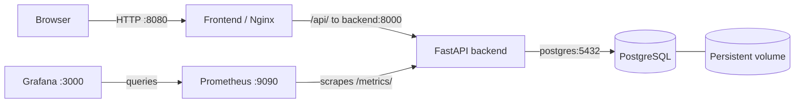
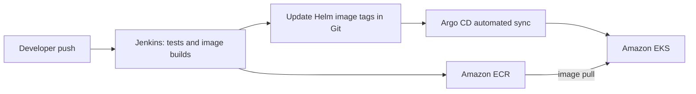

# Padel Match Tracker

**A DevOps portfolio project built around a three-tier padel match tracking application.**

The application allows users to record match results, view match history, and delete selected matches. It provides a practical workload for building and understanding a complete delivery process: application development, automated testing, containers, infrastructure as code, Kubernetes deployment, monitoring, and CI/CD.

**Current stage:** the application and monitoring stack have been exercised locally. Terraform infrastructure and application Helm templates are prepared. The complete AWS deployment and automated delivery workflow are still in progress.

[Current progress](#current-progress) · [Development process](#development-process) · [Architecture](#architecture) · [Remaining work](#remaining-work)

## Project goal

Build a repeatable AWS deployment with:

- An EKS cluster with at least two baseline worker nodes and private workload subnets across multiple Availability Zones.
- Karpenter for provisioning additional worker capacity.
- Helm for application configuration, health checks, resource management, and scaling.
- Jenkins for testing, building container images, and publishing them to Amazon ECR.
- Argo CD for deploying the configuration stored in Git.
- Prometheus and Grafana for application and cluster monitoring.
- Private access for administration and monitoring.
- A documented deployment process that can ultimately be started from one entry point after prerequisites and credentials are configured.

This is an ongoing personal implementation of a technical assignment. Features described as planned have not yet been demonstrated end to end.

## Current progress

| Component | What has been built | Current status |
| --- | --- | --- |
| Backend | FastAPI API, PostgreSQL model, input validation, structured errors, and match creation, listing, and deletion | Implemented and exercised locally |
| Frontend | HTML, CSS, and JavaScript interface with match form, history, deletion confirmation, and user feedback | Implemented and exercised locally |
| Database | PostgreSQL, Alembic migration, and persistent local storage | Local integration verified |
| Automated tests | Isolated test database and API tests for health, match operations, validation, and metrics | 8 tests passed in the most recent reported development run |
| Containers | Separate backend/frontend images, Nginx reverse proxy, and Docker Compose | Images built and services run locally |
| Application monitoring | API metrics, Prometheus collection, and a Grafana data source and application dashboard provisioned from files | Verified locally |
| Availability alert | Prometheus backend-down rule and a script that stops and restores the backend | Alert firing and recovery verified locally |
| Application Helm chart | Deployments, Services, ConfigMaps, Secret template, database StatefulSet, storage, probes, resources, migration Job, optional HPA and Ingress | Linted and rendered; EKS runtime validation remains pending |
| AWS infrastructure | Terraform modules for networking, IAM, EKS, ECR, private management access, and Karpenter prerequisites | Configuration validated and planned; full AWS environment operation remains pending |
| Remote Terraform state | S3 bootstrap, encryption, versioning, public-access blocking, and backend initialization script | Bootstrap applied and configuration checked during development |
| CI/CD and GitOps | Target Jenkins, ECR, Git, Argo CD, and EKS workflow | Implementation pending |

Validation above refers to previous development sessions. It does not represent a fresh test run, a live public service, or a completed cloud deployment.

## Development process

The project has been built in stages so each layer can be understood and checked before the next layer depends on it.

### 1. Define and implement the application

An initial [application contract](docs/APP-CONTRACT.md) established the match data and validation rules. The backend separates request/response structures, database models, connection settings, and API routes. Alembic records database schema changes.

**Purpose:** define clear application behavior and manage database changes consistently.

### 2. Add tests and health checks

Integration tests use a separate PostgreSQL test database. The API exposes separate liveness and readiness endpoints and returns structured validation errors.

**Purpose:** catch regressions, protect development data during testing, and distinguish a running API process from database connectivity.

### 3. Package the services

The backend runs in a Python container. Nginx serves the frontend and forwards API requests to the backend. Docker Compose connects the services and provides persistent volumes.

**Purpose:** create a consistent development environment and keep service configuration in version-controlled files.

### 4. Complete the browser workflows

The interface supports saving, listing, and deleting matches. Frontend builds generate content-based asset filenames so browsers can load updated JavaScript and CSS after changes.

**Purpose:** provide a usable sample application and avoid serving stale interface code.

### 5. Prepare Kubernetes deployment templates

The Helm chart defines the application workloads, internal Services, configuration, database storage, resource requests and limits, health probes, migration Job, and optional HPA and internal Ingress.

**Purpose:** describe application deployment in reusable templates with environment-specific values.

### 6. Add observability and failure verification

The backend exposes request counts, duration histograms, and error counters. Prometheus collects these metrics, while Grafana loads its data source and application dashboard from repository files. A controlled failure script verifies the backend availability alert and attempts to restore the service on exit.

**Purpose:** observe application behavior and practice diagnosing failures before moving the monitoring stack into EKS.

### 7. Prepare the AWS foundation

Terraform modules define the network, separate IAM roles, EKS control plane, a managed group with two baseline workers, ECR repositories, and a private management host. A separate bootstrap creates protected S3 storage for development Terraform state.

**Purpose:** make infrastructure changes reviewable and repeatable, with explicit configuration and access boundaries.

### 8. Prepare Karpenter and management tooling

The repository contains Karpenter IAM/OIDC prerequisites, discovery tags, a node instance profile, and initial NodePool and EC2NodeClass manifests. Management host startup prepares Session Manager, kubectl, and Helm with download checks and retry handling.

**Purpose:** prepare private cluster administration and the permissions and configuration needed for dynamic node provisioning.

**Current stopping point:** management tool preparation and the Karpenter foundation are committed. Installation and runtime verification of Karpenter on the target cluster remain pending.

## Architecture

### Implemented local environment



Browser requests use relative API paths. Nginx resolves the backend through the internal Docker network. PostgreSQL, Prometheus, and Grafana each use a persistent volume.

Compose publishes ports on the Docker host's loopback interface. When that host is a remote VM, SSH or editor port forwarding is needed to access the interfaces from another computer.

### Planned delivery workflow



The cloud design uses private workload subnets, a private EKS API endpoint, and a private management host accessed through AWS Systems Manager Session Manager. The application chart includes an optional internal ALB Ingress.

**Networking decision to resolve:** the current Terraform module includes a public egress subnet for a NAT Gateway. Workloads remain private, but a literal requirement for private subnets only still needs to be reconciled before final deployment.

## Repository structure

| Path | Responsibility |
| --- | --- |
| [`backend/`](backend/) | API source, database model, migrations, dependencies, and tests |
| [`frontend/`](frontend/) | Browser interface, Nginx configuration, and frontend container build |
| [`kubernetes/helm/padel-match-tracker/`](kubernetes/helm/padel-match-tracker/) | Application Helm chart and values |
| [`kubernetes/addons/karpenter/`](kubernetes/addons/karpenter/) | Initial Karpenter NodePool and EC2NodeClass |
| [`observability/`](observability/) | Prometheus configuration and alerts, Grafana provisioning, and dashboard JSON |
| [`scripts/`](scripts/) | Local startup, demo traffic, alert verification, and Terraform backend initialization |
| [`terraform/bootstrap/state/`](terraform/bootstrap/state/) | S3 storage bootstrap for Terraform state |
| [`terraform/environments/dev/`](terraform/environments/dev/) | Development module wiring, inputs, outputs, and remote-state configuration |
| [`terraform/modules/`](terraform/modules/) | Networking, IAM, EKS, ECR, management, and Karpenter resource modules |
| [`docs/`](docs/) | Initial application contract |
| [`compose.yaml`](compose.yaml) | Local application and monitoring services |
| [`.env.example`](.env.example) | Required local configuration names with placeholder passwords |

## Local operation

The local environment uses Docker Compose, Bash, and curl. Local passwords are configured in an ignored `.env` file using `.env.example` as a reference.

For a fresh checkout, configure `.env` first, then build the backend and apply database migrations:

```bash
docker compose build backend
docker compose run --rm backend alembic upgrade head
./scripts/local-up.sh
```

For an existing configured environment:

```bash
./scripts/local-up.sh
```

The startup script checks prerequisites, validates Compose configuration, builds application images, starts services, and waits for HTTP readiness checks. It does not apply database migrations; apply new migrations separately when the schema changes.

| Interface | Local address |
| --- | --- |
| Application | http://127.0.0.1:8080/ |
| API documentation | http://127.0.0.1:8000/docs |
| Prometheus | http://127.0.0.1:9090/ |
| Grafana | http://127.0.0.1:3000/ |

Grafana loads the Prometheus data source and application dashboard automatically from files. Its initial administrator password comes from local configuration.

## Remaining work

- [ ] **Finalize and provision the AWS environment.** Resolve the private-subnet-only egress requirement, verify supported component versions and capacity, and confirm at least two ready baseline worker nodes.
- [ ] **Verify private administration and access.** Test Session Manager connectivity, management tools, private cluster access, and access to application and monitoring interfaces.
- [ ] **Install cluster dependencies and Karpenter.** Configure the required networking, storage, metrics, and load-balancer components. Connect the Karpenter controller to its IAM role and verify provisioning for unschedulable pods.
- [ ] **Deploy the application to EKS.** Publish images to ECR, configure deployment values and secrets, and verify storage, migrations, health probes, internal Ingress, HPA, and all match workflows.
- [ ] **Configure Argo CD.** Add Application manifests, repository access, automated synchronization, and the required branching/promotion strategy.
- [ ] **Implement Jenkins CI/CD.** Run isolated tests, build and push commit-tagged images to ECR, update Helm image tags in Git, and demonstrate deployment through Argo CD after a code change.
- [ ] **Complete cluster observability.** Install Prometheus and Grafana using Helm, adapt metrics discovery and alert rules, retain the application dashboard, and add the second required custom dashboard for cluster CPU, memory, and network metrics.
- [ ] **Finish deployment automation and documentation.** Provide one deployment entry point after prerequisite configuration, document teardown and state retention, add `ARCHITECTURE.md` and `DEPLOYMENT.md`, and record the complete working demonstration.

## Current limitations and design decisions

- The application has one PostgreSQL instance. Persistent storage is configured; database replication and automated backups are not implemented.
- The current network uses one NAT Gateway as a development cost trade-off, creating an egress dependency on one Availability Zone.
- Application authentication is outside the sample's current scope; the target application access path is private.
- The readiness endpoint checks database connectivity, not completion of every schema migration.
- HPA and Ingress are disabled by default, and Helm values still reference local images until the cloud delivery workflow is connected.
- One custom application dashboard exists; the cluster dashboard is still pending.
- The browser favicon needs a final visual check.
- Terraform validation and Helm rendering are preparation checks; cloud runtime behavior still requires deployment verification.

## Project principles

- Understand the purpose of each component and verify it before depending on it.
- Keep secrets, local variable files, Terraform state, and private keys outside Git.
- Use version-controlled configuration and repeatable scripts.
- Keep implementation status and remaining work visible.
- Complete the assignment requirements before adding optional features.
